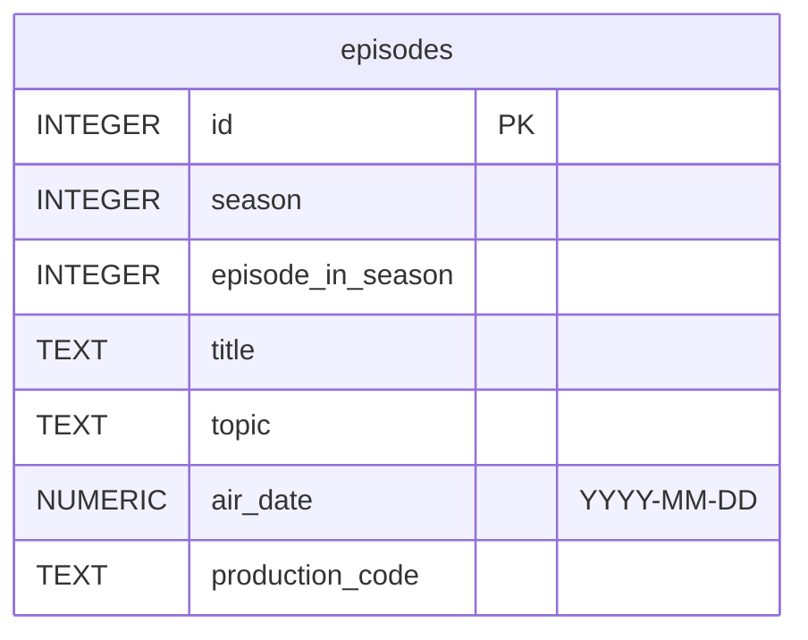

# Cyberchase

**Etapa 1 · Consultas** · [Enunciado oficial](https://cs50.harvard.edu/sql/psets/0/cyberchase/)

`SELECT` · `WHERE` · `AND`/`OR` · `LIKE` · `BETWEEN` · `IS NULL` · `ORDER BY` · `COUNT(DISTINCT)`

## Contexto

*Cyberchase* é uma série animada educativa da PBS, no ar desde 2002, que ensina matemática para crianças. O banco `cyberchase.db` traz uma única tabela, `episodes`, com os 140 episódios exibidos entre 2002 e 2023.

## Problema a resolver

A PBS quer respostas sobre o catálogo: episódios por temporada, episódios sem tema cadastrado, quantos foram ao ar em cada período, títulos repetidos. São 13 perguntas, cada uma respondida por **uma única consulta** que não pode depender de valores fixos de `id` e deve devolver só as colunas pedidas.

## Modelo de dados



## Solução

| # | Pergunta | Técnica | Resultado |
|---|---|---|---|
| [1](1.sql) | Títulos da 1ª temporada | `WHERE` | 26 linhas |
| [2](2.sql) | Temporada e título do 1º episódio de cada temporada | `WHERE` | 14 linhas |
| [3](3.sql) | Código de produção de "Hackerized!" | `WHERE` com texto | `CYB091` |
| [4](4.sql) | Episódios sem tema cadastrado | `IS NULL` | 26 linhas |
| [5](5.sql) | Episódio de fim de ano exibido em 31/12/2004 | filtro por data | *Starlight Night* |
| [6](6.sql) | Episódios da 6ª temporada (2008) lançados antes, em 2007 | `AND` + `LIKE '2007%'` | 2 linhas |
| [7](7.sql) | Títulos e temas dos episódios sobre frações | `LIKE '%fractions%'` | 6 linhas |
| [8](8.sql) | Episódios lançados de 2018 a 2023 | `COUNT` + `BETWEEN` | 31 |
| [9](9.sql) | Episódios lançados de 2002 a 2007 | `COUNT` + `BETWEEN` | 74 |
| [10](10.sql) | Id, título e código de todos, por código de produção | `ORDER BY` | 140 linhas |
| [11](11.sql) | Títulos da 5ª temporada em ordem alfabética reversa | `ORDER BY ... DESC` | 10 linhas |
| [12](12.sql) | Quantidade de títulos únicos | `COUNT(DISTINCT)` | 136 |
| [13](13.sql) | *Pergunta própria:* episódios da 5ª temporada exibidos em 2006 | `WHERE` + `AND` | 5 linhas |

## Destaques

- **Datas como texto ISO.** `air_date` está no formato `YYYY-MM-DD`, então `LIKE '2007%'` e `BETWEEN '2018-01-01' AND '2023-12-31'` funcionam por comparação lexicográfica, sem conversão de tipo.
- **140 episódios, 136 títulos.** A consulta 12 mostra que há títulos repetidos no catálogo, um detalhe que um `COUNT(*)` esconderia.

## Evidência

Saída de `7.sql` (5 de 6 linhas):

| title | topic |
|---|---|
| Zeus on the Loose | Fractions |
| Harriet Hippo & the Mean Green | Equivalent Fractions |
| Shari Spotter and the Cosmic Crumpets | Mixed-Number Fractions |
| A Fraction of a Chance | Fractions 101 |
| Peace, Love, and Hackerness | Measuring with Mixed Number Fractions |

## Como executar

```bash
sqlite3 cyberchase.db < 7.sql
```

## Revisão pós-curso

- `13.sql`: comentário trocado de `#` para `--`. O `#` só é aceito pelo shell do `sqlite3` e quebra em qualquer outro cliente.
- `3.sql`, `8.sql`, `9.sql`: textos e datas passaram de aspas duplas para aspas simples. No padrão SQL, aspas duplas indicam identificadores; o SQLite só aceita o outro uso como fallback.
