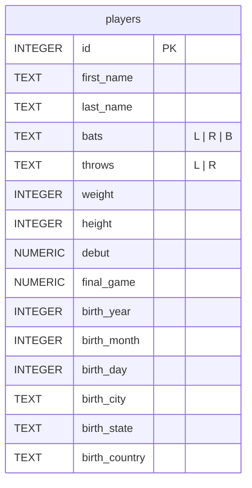

# Players

**Etapa 1 · Consultas** · [Enunciado oficial](https://cs50.harvard.edu/sql/psets/0/players/)

`SELECT` · `WHERE` · `IS NULL` · `!=` · precedência `AND`/`OR` · `AVG` · `ROUND` · `||` · ordenação composta

## Contexto

A MLB (Major League Baseball) é a liga profissional de beisebol dos EUA desde 1876. O banco `players.db` tem 20.769 jogadores, de 1871 a 2023, com dados de nascimento, físico, lado de rebatida e arremesso e as datas da estreia e do último jogo.

## Problema a resolver

Explorar o cadastro de jogadores com 10 consultas: localizar ídolos (Jackie Robinson, Babe Ruth), encontrar registros incompletos, filtrar por origem e posição e calcular médias físicas de uma geração. Cada consulta precisa reproduzir exatamente a contagem de linhas que o enunciado publica.

## Modelo de dados



## Solução

Todas as contagens batem com as publicadas no enunciado. A coluna "Esperado" mostra o valor oficial.

| # | Pergunta | Técnica | Obtido | Esperado |
|---|---|---|---|---|
| [1](1.sql) | Cidade, estado e país de nascimento de Jackie Robinson | `WHERE` + `AND` | 1 | 1 |
| [2](2.sql) | Lado de rebatida de Babe Ruth | `WHERE` | 1 | 1 |
| [3](3.sql) | Ids de jogadores sem data de estreia | `IS NULL` | 213 | 213 |
| [4](4.sql) | Nascidos fora dos EUA, por nome e sobrenome | `!=` + `ORDER BY` | 2814 | 2814 |
| [5](5.sql) | Rebatedores destros, por nome e sobrenome | `ORDER BY` composto | 12878 | 12878 |
| [6](6.sql) | Nascidos em Pittsburgh, PA, da estreia mais recente para a mais antiga | `ORDER BY debut DESC, ...` | 134 | 134 |
| [7](7.sql) | Quantos rebatem com uma mão e arremessam com a outra | `AND`/`OR` combinados | 1 (2925) | 1 |
| [8](8.sql) | Altura e peso médios de quem estreou a partir de 2000 | `ROUND(AVG())` + `AS` | 1 | 1 |
| [9](9.sql) | Jogadores cujo último jogo foi em 2022 | `BETWEEN` em datas | 516 | 516 |
| [10](10.sql) | *Pergunta própria:* jogadores nascidos no Brasil | concatenação `\|\|` + `AS` | 5 | — |

## Destaques

- **Precedência de operadores.** `7.sql` usa `bats = 'R' AND throws = 'L' OR bats = 'L' AND throws = 'R'`. Funciona porque `AND` tem precedência sobre `OR`. Parênteses deixariam a intenção mais explícita.
- **Pergunta própria com um recorte brasileiro.** `10.sql` encontra os 5 brasileiros que chegaram à MLB, todos do estado de São Paulo:

| Brazilian Players | birth_city | birth_state | birth_year |
|---|---|---|---|
| Paulo Orlando | Sao Paulo | Sao Paulo | 1985 |
| Yan Gomes | Sao Paulo | Sao Paulo | 1987 |
| Andre Rienzo | Sao Paulo | Sao Paulo | 1988 |
| Thyago Vieira | Sao Paulo | Sao Paulo | 1993 |
| Luiz Gohara | Tupa | Sao Paulo | 1996 |

## Como executar

```bash
sqlite3 players.db < 10.sql
```

## Revisão pós-curso

- **`9.sql` estava errado.** A versão entregue filtrava `final_game` entre 2020 e 2029 e devolvia **2161 linhas**. O enunciado pede o último jogo **em 2022**, que dá **516 linhas**. O filtro agora é `BETWEEN '2022-01-01' AND '2022-12-31'`. O erro foi pego ao comparar a saída com a contagem oficial, verificação que hoje roda automaticamente em [`scripts/verificar.sh`](../../scripts/verificar.sh).
