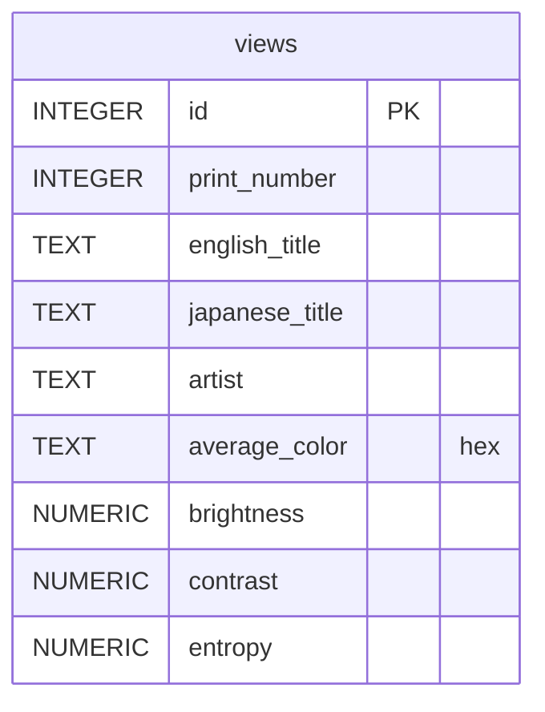

# 36 Views

**Etapa 1 · Consultas** · [Enunciado oficial](https://cs50.harvard.edu/sql/psets/0/views/)

`SELECT` · `WHERE` · `LIKE` · `MAX` · `AVG` · `ROUND` · `AS` · `ORDER BY` + `LIMIT`

## Contexto

Entre 1830 e 1832, Katsushika Hokusai produziu as *36 Vistas do Monte Fuji*, série de xilogravuras japonesas. Anos depois, Utagawa Hiroshige fez a sua própria série de 36 vistas. O banco `views.db` reúne as 72 gravuras com títulos em japonês e inglês, artista e métricas de imagem calculadas: cor média, brilho, contraste e entropia.

## Problema a resolver

Responder a 10 perguntas sobre o acervo, comparando os dois artistas por meio das métricas: contagens por tema, a gravura de maior contraste, a entropia média, as mais claras e as mais escuras. As regras são as mesmas da etapa: uma consulta por arquivo, sem `id` fixo e com as colunas nomeadas como o enunciado pede.

## Modelo de dados



## Solução

| # | Pergunta | Técnica | Resultado |
|---|---|---|---|
| [1](1.sql) | Título japonês e inglês de cada gravura | projeção | 72 linhas |
| [2](2.sql) | Cor média das gravuras de Hokusai com "river" no título | `LIKE` + `AND` | 3 linhas |
| [3](3.sql) | Quantas gravuras de Hokusai têm "Fuji" no título | `COUNT` + `LIKE` | 4 |
| [4](4.sql) | Quantas gravuras de Hiroshige citam a "Eastern Capital" | `LIKE '%Eastern%Capital%'` | 9 |
| [5](5.sql) | Maior contraste entre as de Hokusai, como "Maximum Contrast" | `MAX` + `AS` | 0.65 |
| [6](6.sql) | Entropia média de Hiroshige com 2 casas, como "Hiroshige Average Entropy" | `ROUND(AVG())` | 7.42 |
| [7](7.sql) | As 5 gravuras mais claras de Hiroshige | `ORDER BY DESC LIMIT 5` | 5 linhas |
| [8](8.sql) | As 5 de Hokusai com menor contraste | `ORDER BY ASC LIMIT 5` | 5 linhas |
| [9](9.sql) | Título e artista da gravura mais clara | `ORDER BY DESC LIMIT 1` | *A View of Mount Fuji Across Lake Suwa* (Hokusai) |
| [10](10.sql) | *Pergunta própria:* as 5 gravuras mais claras de Hokusai | `AS` + `WHERE` + `ORDER BY` | 5 linhas |

## Destaques

- **Curinga no meio do padrão.** Em `4.sql`, `'%Eastern%Capital%'` aceita variações como "Eastern Capital" e "the Eastern Capital", que uma igualdade exata perderia.
- **Top-N com `ORDER BY ... LIMIT`** em vez de subconsulta com `MAX`, o que permite pedir as N primeiras (7, 8 e 10) e não só a primeira (9).

## Evidência

Saída de `7.sql`:

| english_title |
|---|
| The Sea off the Miura Peninsula in Sagami Province |
| Futami Bay in Ise Province |
| The Sumida Embankment in the Eastern Capital |
| Sukiyagashi in the Eastern Capital |
| Cherry Blossoms at Honmoku in Musashi Province |

## Como executar

```bash
sqlite3 views.db < 6.sql
```

## Revisão pós-curso

- `10.sql`: `"Hokusai"` passou para `'Hokusai'`. Aspas duplas indicam identificador no padrão SQL.
