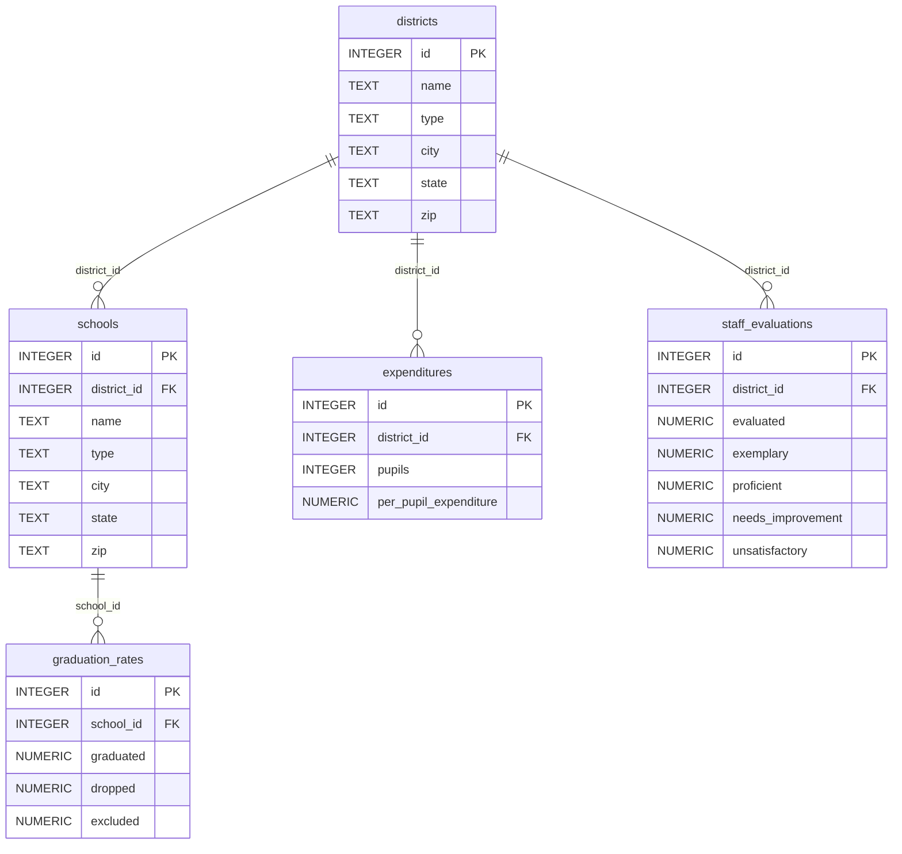

# DESE

**Etapa 2 · Relacionamentos** · [Enunciado oficial](https://cs50.harvard.edu/sql/psets/1/dese/)

`JOIN` (até 4 tabelas) · subconsulta escalar · `GROUP BY` + `HAVING` · `AVG` · `MIN` · ordenação composta

## Contexto

O DESE (Massachusetts Department of Elementary and Secondary Education) supervisiona a educação pública do estado de Massachusetts. O banco `dese.db` combina dados públicos do órgão: distritos, escolas, taxas de formatura, gasto por aluno e avaliação de professores.

## Problema a resolver

Como analista de dados recém-contratado, responder a 12 perguntas da diretoria sobre oferta escolar, gastos e desempenho. As perguntas exigem cruzar escolas com distritos, comparar cada distrito com a média estadual e propor um indicador próprio (pergunta 13).

## Modelo de dados



## Solução

Todas as contagens batem com as publicadas no enunciado.

| # | Pergunta | Técnica | Obtido | Esperado |
|---|---|---|---|---|
| [1](1.sql) | Nome e cidade das escolas públicas (sem as charter) | `WHERE` | 1761 | 1761 |
| [2](2.sql) | Distritos desativados, marcados com "(non-op)" | `LIKE` | 121 | 121 |
| [3](3.sql) | Gasto médio por aluno, com peso igual por distrito | `AVG` + `AS` | 1 | 1 |
| [4](4.sql) | As 10 cidades com mais escolas públicas | `GROUP BY` + `ORDER BY` + `LIMIT` | 10 | 10 |
| [5](5.sql) | Cidades com até 3 escolas públicas | `GROUP BY` + `HAVING` | 201 | 201 |
| [6](6.sql) | Escolas com 100% de formatura | `JOIN` | 9 | 9 |
| [7](7.sql) | Escolas do distrito de Cambridge | `JOIN` | 17 | 17 |
| [8](8.sql) | Distritos e número de alunos | `JOIN` | 396 | 396 |
| [9](9.sql) | Distrito(s) com menos alunos | `JOIN` + subconsulta `MIN` | 1 (*Savoy*) | 1 |
| [10](10.sql) | Os 10 distritos públicos que mais gastam por aluno | `JOIN` + `ORDER BY` + `LIMIT` | 10 | 10 |
| [11](11.sql) | Escola, gasto do distrito e taxa de formatura | `JOIN` de 3 tabelas | 391 | 391 |
| [12](12.sql) | Distritos públicos acima da média em gasto **e** em % de professores "exemplary" | 2 subconsultas escalares | 65 | 65 |
| [13](13.sql) | *Pergunta própria:* as 10 escolas públicas com melhor índice de desempenho | `JOIN` de 4 tabelas + métrica derivada | 10 | — |

## Destaques

- **Comparação com a média em uma consulta só.** `12.sql` filtra contra duas médias calculadas em subconsultas escalares, sem números fixos no código. Se os dados mudarem, a consulta continua correta.
- **"Distritos com menos alunos", no plural.** `9.sql` compara com `(SELECT MIN(...))` em vez de usar `ORDER BY ... LIMIT 1`, então devolve todos os distritos em caso de empate, como o enunciado pede.
- **Indicador próprio (pergunta 13).** O *School Performance Index* é a média simples entre a taxa de formatura da escola e o percentual de professores "proficient" do distrito:

| district | school | graduated | proficient | School Performance Index |
|---|---|---|---|---|
| Lexington | Lexington High | 98.7 | 99.4 | 99.05 |
| Belmont | Belmont High | 99.7 | 97.4 | 98.55 |
| Bedford | Bedford High | 98.4 | 98.2 | 98.30 |
| Ashland | Ashland High | 97.2 | 99.3 | 98.25 |
| Northboro-Southboro | Algonquin Regional High | 97.9 | 98.6 | 98.25 |

## Como executar

```bash
sqlite3 dese.db < 12.sql
```

## Revisão pós-curso

- Textos como `"Public School"` e `"Cambridge"` passaram para aspas simples (arquivos 4, 5, 7, 10, 12 e 13).
- `13.sql`: as duas colunas `name` ganharam os aliases `district` e `school`, para que o resultado fique legível.

## Limitações

- O índice da pergunta 13 mistura um dado da **escola** (formatura) com um dado do **distrito** (avaliação dos professores) e dá peso igual aos dois. Serve como exercício de `JOIN`, mas não é uma métrica validada de desempenho escolar.
