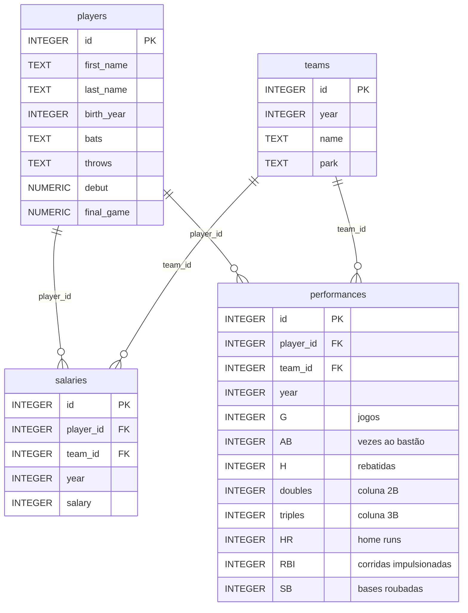

# Moneyball

**Etapa 2 · Relacionamentos** · [Enunciado oficial](https://cs50.harvard.edu/sql/psets/1/moneyball/)

`JOIN` com chave composta · `GROUP BY` · `SUM`/`AVG` · subconsultas com `ORDER BY ... LIMIT` · interseção de rankings · métrica de custo-benefício

## Contexto

Em 2001, o Oakland Athletics tinha uma das menores folhas salariais da MLB e precisava montar um time competitivo mesmo assim. A história, contada no livro e no filme *Moneyball*, ficou conhecida pelo uso de dados para achar jogadores subvalorizados. O banco `moneyball.db` traz jogadores, times, salários e estatísticas de rebatida por ano até 2001.

## Problema a resolver

Como analista do Oakland em 2001, responder a 12 perguntas que vão do contexto do mercado (evolução dos salários, quem ganha mais) até a decisão de contratação: **quais jogadores entregam mais rebatidas e mais RBIs por dólar pago?**

## Modelo de dados



*Diagrama simplificado: `players` tem também peso, altura e local de nascimento.*

## Solução

Todas as contagens batem com as publicadas no enunciado.

| # | Pergunta | Técnica | Obtido | Esperado |
|---|---|---|---|---|
| [1](1.sql) | Salário médio por ano | `GROUP BY` + `ROUND(AVG())` | 17 | 17 |
| [2](2.sql) | Histórico salarial de Cal Ripken Jr. | `JOIN` | 17 | 17 |
| [3](3.sql) | Home runs por ano de Ken Griffey Jr. (nascido em 1969) | `JOIN` + desambiguação por `birth_year` | 13 | 13 |
| [4](4.sql) | Os 50 salários mais baixos de 2001 | `JOIN` + 4 critérios de desempate | 50 | 50 |
| [5](5.sql) | Times em que Satchel Paige jogou | `JOIN` de 3 tabelas + `DISTINCT` | 3 | 3 |
| [6](6.sql) | Os 5 times com mais rebatidas em 2001 | `JOIN` + `SUM` + `GROUP BY` | 5 | 5 |
| [7](7.sql) | Maior salário da história | subconsulta `MAX` | 1 (*Alex Rodriguez*) | 1 |
| [8](8.sql) | Salário em 2001 do líder de home runs de 2001 | `JOIN` por jogador **e** ano + subconsulta | 1 (US$ 10.300.000) | 1 |
| [9](9.sql) | Os 5 times com menor salário médio em 2001 | `GROUP BY` + `AVG` + `LIMIT` | 5 | 5 |
| [10](10.sql) | Relatório jogador × ano: salário e home runs | `JOIN` com chave composta | 14915 | 14915 |
| [11](11.sql) | Os 10 jogadores mais baratos por rebatida em 2001 | métrica `salary / H` | 10 | 10 |
| [12](12.sql) | Quem está no top 10 de custo por rebatida **e** no de custo por RBI | duas subconsultas `IN (... LIMIT 10)` | 6 | 6 |

## Destaques

- **A chave da junção é (jogador, ano).** `salaries` e `performances` têm uma linha por jogador **por ano**. Juntar só por `player_id` cruzaria o salário de um ano com o desempenho de todos os outros. Por isso `10.sql`, `11.sql` e `12.sql` usam `ON player_id = player_id AND year = year`.
- **Interseção de dois rankings (pergunta 12).** Cada subconsulta calcula um top 10 próprio, com `ORDER BY` e `LIMIT` dentro do `IN`, e o `WHERE` exige os dois ao mesmo tempo. O resultado é a lista curta de reforços eficientes nos dois critérios:

| first_name | last_name |
|---|---|
| Torii | Hunter |
| Paul | Lo Duca |
| Terrence | Long |
| Doug | Mientkiewicz |
| Albert | Pujols |
| Aramis | Ramirez |

- **O contexto do mercado.** O salário médio na MLB passou de US$ 964.979 em 1995 para US$ 2.279.841 em 2001 (`1.sql`), e o próprio Oakland aparece entre os 5 times de menor salário médio de 2001 (`9.sql`).

## Como executar

```bash
sqlite3 moneyball.db < 12.sql
```

## Revisão pós-curso

- **`8.sql` ganhou o casamento de ano no `JOIN`.** A versão entregue juntava `salaries` (2001) com `performances` de **qualquer** ano e só depois filtrava pelo número de home runs. Com estes dados o resultado coincide (US$ 10.300.000), mas um jogador com o mesmo total de home runs em outro ano entraria no resultado. Agora a consulta usa `AND "performances"."year" = "salaries"."year"`, a mesma regra das perguntas 10 a 12.

## Limitações

- Em `11.sql`, `salary / H` é uma divisão inteira, porque as duas colunas são `INTEGER`, e o valor sai truncado (Albert Pujols: 1030 em vez de 1030,93). A ordenação não muda com estes dados, mas `salary * 1.0 / H` daria o valor exato.
