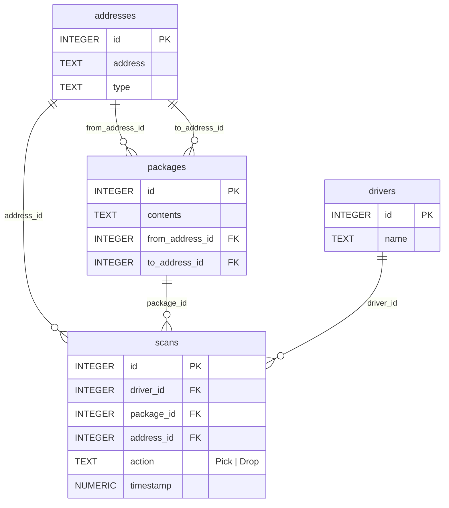

# Packages, Please

**Etapa 2 · Relacionamentos** · [Enunciado oficial](https://cs50.harvard.edu/sql/psets/1/packages/)

investigação passo a passo · chaves estrangeiras · `IS NULL` · navegação entre tabelas · registro do raciocínio em SQL

## Contexto

Você é atendente de uma agência dos correios em Boston e três encomendas sumiram. O banco `packages.db` registra endereços, motoristas, encomendas e cada leitura de código de barras (`Pick` = coleta, `Drop` = entrega), com data e hora.

## Problema a resolver

Descobrir o paradeiro de três encomendas a partir de pistas em linguagem natural:

| Caso | Pista | Pergunta |
|---|---|---|
| **The Lost Letter** | Uma carta de parabéns enviada de 900 Somerville Avenue | Onde ela foi parar e que tipo de endereço é esse? |
| **The Devious Delivery** | Uma encomenda sem remetente | Onde ela está e o que contém? |
| **The Forgotten Gift** | Um presente enviado de 109 Tileston Street | O que é e quem está com ele agora? |

A entrega tem duas partes: [`log.sql`](log.sql), com **todas** as consultas executadas e um comentário explicando cada uma, e [`answers.txt`](answers.txt), com as respostas.

## Modelo de dados



## Solução

| Caso | Caminho da investigação | Resposta |
|---|---|---|
| The Lost Letter | `packages` (conteúdo "congratulatory") → `scans` do pacote → `addresses` do destino | **2 Finnigan Street**, endereço residencial |
| The Devious Delivery | `packages` com `from_address_id IS NULL` → `scans` → endereço do `Drop` | **Duck debugger**, entregue numa **delegacia de polícia** |
| The Forgotten Gift | `addresses` (109 Tileston St.) → `packages` enviados de lá → `scans` → último `Pick` → `drivers` | **Flores**, em posse do motorista **Mikel** |

## Destaques

- **Buscar pelo dado confiável.** A cliente da carta informa o destino como "2 Finnegan Street", mas o endereço cadastrado é "2 Finnigan Street". Uma busca pelo endereço digitado não acharia nada. A investigação começou pelo **conteúdo** (`LIKE '%congratulatory%'`) e seguiu as chaves estrangeiras até o endereço real.
- **A última leitura conta a história.** No caso do presente, os `scans` mostram coleta, entrega num **depósito** e uma **nova coleta** por outro motorista, sem entrega posterior. A resposta está no último evento, não no endereço de destino cadastrado.
- **O log como trilha de auditoria.** Cada consulta vem acompanhada dos ids e valores encontrados, em comentário, de modo que outra pessoa consegue refazer o raciocínio sem rodar nada.

## Como executar

```bash
sqlite3 packages.db < log.sql
```

## Revisão pós-curso

- `log.sql`: `"109 Tileston Street"` passou para aspas simples, o padrão para textos em SQL.

## Limitações

- O log usa ids descobertos em passos anteriores (por exemplo, `WHERE "package_id" = 384`). Para uma investigação documentada isso é intencional, mas uma versão reutilizável encadearia os passos com subconsultas ou `JOIN`s.
