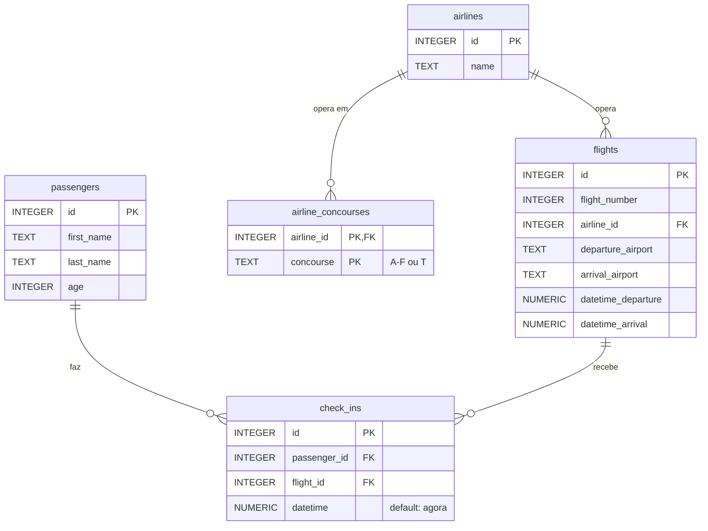

# ATL

**Etapa 3 · Modelagem** · [Enunciado oficial](https://cs50.harvard.edu/sql/psets/2/atl/)

`CREATE TABLE` · `PRIMARY KEY` composta · `FOREIGN KEY` · `CHECK` · `NOT NULL` · `DEFAULT CURRENT_TIMESTAMP` · normalização

## Contexto

O Aeroporto Internacional Hartsfield-Jackson, em Atlanta (código "ATL"), é o mais movimentado do mundo desde 1998 e recebeu 93,7 milhões de passageiros em 2022. Ele opera até 1.000 voos por dia.

## Problema a resolver

Projetar do zero, em SQLite, o banco que registra **passageiros**, **check-ins**, **companhias aéreas** (e os terminais onde operam) e **voos**. O schema precisa estar normalizado e conseguir representar os dados de exemplo do enunciado: a passageira Amelia Earhart, de 39 anos, faz check-in no voo 300 da Delta (ATL → BOS) em 3 de agosto de 2023.

## Modelo de dados



Arquivos: [`schema.sql`](schema.sql) (o schema) e [`dados_exemplo.sql`](dados_exemplo.sql) (os dados do enunciado).

## Decisões de modelagem

| Decisão | Por quê |
|---|---|
| Tabela `airline_concourses` separada, com chave `(airline_id, concourse)` | Uma companhia opera em vários terminais (a Delta usa A, B, C, D e T). Guardar uma lista numa coluna violaria a 1ª forma normal. A chave composta impede o mesmo terminal duas vezes para a mesma companhia. |
| `CHECK (concourse IN ('A','B','C','D','E','F','T'))` | Só aceita os terminais que existem no ATL. Um terminal inválido é rejeitado na inserção. |
| `flight_number` sem `UNIQUE` | O enunciado avisa que números de voo se repetem. O voo é identificado pelo `id`, e o número é só um atributo. |
| `check_ins.datetime` com `DEFAULT CURRENT_TIMESTAMP` | No uso real o check-in acontece "agora". O default evita depender da aplicação para gravar o horário. |
| Códigos de aeroporto como `TEXT` | São códigos IATA ("ATL", "BOS"). Não há tabela de aeroportos porque o enunciado não pede atributos deles. |

## Evidência

[`scripts/verificar.sh`](../../scripts/verificar.sh) carrega `schema.sql` e `dados_exemplo.sql` com `PRAGMA foreign_keys = ON` e roda `PRAGMA foreign_key_check`. Resultado: **sem erros**.

## Como executar

```bash
sqlite3 atl.db ".read schema.sql" ".read dados_exemplo.sql"
```

## Limitações

- `passengers.age` guarda a idade, que fica desatualizada com o tempo. É o que o enunciado pede, mas num sistema real seria melhor guardar a data de nascimento.
- `flights.airline_id` já é `NOT NULL`, mas `check_ins.passenger_id` e `flight_id` aceitam `NULL`. Um `NOT NULL` nessas colunas impediria check-ins órfãos.
