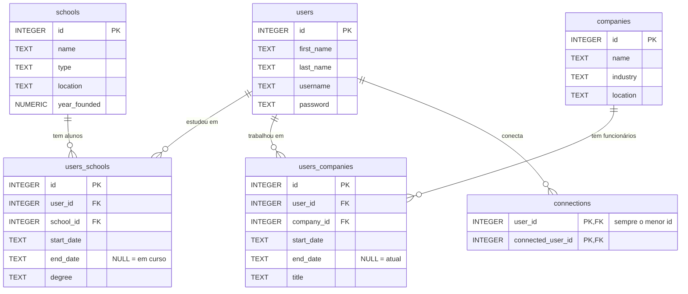

# Happy to Connect (SQLite)

**Etapa 3 · Modelagem** · [Enunciado oficial](https://cs50.harvard.edu/sql/psets/2/connect/)

relacionamentos N:N · tabelas associativas com atributos · auto-relacionamento · `CHECK` entre colunas · normalização

## Contexto

O LinkedIn é uma rede profissional em que as pessoas publicam a trajetória acadêmica e profissional e se conectam com outras pessoas, escolas e empresas.

## Problema a resolver

Projetar em SQLite o banco de uma rede no estilo do LinkedIn, com **usuários**, **escolas**, **empresas** e três tipos de vínculo: conexões **mútuas** entre usuários, passagens por escolas (início, fim, diploma) e passagens por empresas (início, fim, cargo). O schema precisa representar os dados de exemplo do enunciado: Alan Garber, BA em Harvard de 1973 a 1976, e Reid Hoffman, CEO e Chairman do LinkedIn de 2003 a 2007.

## Modelo de dados



Arquivos: [`schema.sql`](schema.sql) e [`dados_exemplo.sql`](dados_exemplo.sql).

## Decisões de modelagem

| Decisão | Por quê |
|---|---|
| `connections` com `CHECK ("user_id" < "connected_user_id")` | Uma conexão é **mútua**: (Alan, Reid) e (Reid, Alan) são a mesma coisa. Obrigar o menor id na primeira coluna faz cada par existir uma única vez, e a chave primária composta impede duplicatas. O mesmo `CHECK` impede alguém de se conectar consigo mesmo. |
| Vínculos em tabelas associativas (`users_schools`, `users_companies`) | Uma pessoa passa por várias escolas e empresas, e cada uma tem várias pessoas (N:N). Datas, diploma e cargo pertencem ao **vínculo**, não à pessoa nem à instituição. |
| `end_date` aceita `NULL` | Representa um curso em andamento ou o emprego atual. Assim uma empresa encontra os funcionários atuais (`end_date IS NULL`) e os antigos. |
| `id` próprio nas tabelas de vínculo | A mesma pessoa pode voltar à mesma empresa ou escola em outro período. Uma chave `(user_id, company_id)` impediria isso. |

## Evidência

[`scripts/verificar.sh`](../../scripts/verificar.sh) carrega o schema e os dados de exemplo com chaves estrangeiras ativas. Resultado: **sem erros**.

## Como executar

```bash
sqlite3 connect.db ".read schema.sql" ".read dados_exemplo.sql"
```

## Limitações

- `users.username` não é `UNIQUE` e quase todas as colunas aceitam `NULL`. Duas contas com o mesmo nome de usuário seriam aceitas. A [versão em MySQL](../../07-escala/connect-mysql/) corrige isso com `UNIQUE` e `NOT NULL`.
- A senha é guardada como texto, o que o enunciado permite. Em produção seria um hash.
