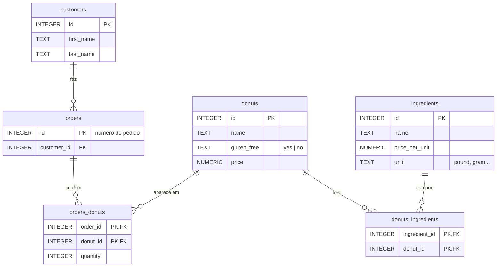

# Union Square Donuts

**Etapa 3 · Modelagem** · [Enunciado oficial](https://cs50.harvard.edu/sql/psets/2/donuts/)

tabelas associativas · `PRIMARY KEY` composta · `CHECK` · atributo no relacionamento (`quantity`) · normalização

## Contexto

A Union Square Donuts é uma doceria com lojas em Boston, Brookline e Somerville. Até hoje ela controla os pedidos em recibos de papel e quer um banco de dados para atender mais clientes, inclusive pela internet.

## Problema a resolver

Projetar em SQLite o banco da operação diária: **ingredientes** (com preço por unidade), **donuts** (sem glúten ou não, preço, ingredientes, incluindo itens que saíram do cardápio), **pedidos** (número, donuts e quantidades, cliente) e **clientes** (com histórico de pedidos). Dados de exemplo do enunciado: o pedido 1, de Luis Singh, com 3 Belgian Dark Chocolate e 2 Back-To-School Sprinkles.

## Modelo de dados



Arquivos: [`schema.sql`](schema.sql) e [`dados_exemplo.sql`](dados_exemplo.sql).

## Decisões de modelagem

| Decisão | Por quê |
|---|---|
| `orders_donuts` com `quantity` e chave `(order_id, donut_id)` | "3 donuts de chocolate" é uma única linha com `quantity = 3`, não três linhas iguais. A chave composta impede o mesmo donut duas vezes no mesmo pedido. |
| `orders.customer_id NOT NULL` | Todo pedido tem exatamente um cliente, como o enunciado exige. O histórico de um cliente é um `JOIN` com `orders`, sem coluna redundante em `customers`. |
| `CHECK (gluten_free IN ('yes', 'no'))` | Restringe a coluna a dois valores válidos, já que o SQLite não tem tipo booleano. |
| `price_per_unit` + `unit` em `ingredients` | O preço só faz sentido junto da unidade (US$ 5,00 **por libra** de cacau). |

## Evidência

[`scripts/verificar.sh`](../../scripts/verificar.sh) carrega o schema e os dados de exemplo com chaves estrangeiras ativas e sem erros. Consulta de conferência do pedido 1:

| first_name | name | quantity |
|---|---|---|
| Luis | Belgian Dark Chocolate | 3 |
| Luis | Back-To-School Sprinkles | 2 |

## Como executar

```bash
sqlite3 donuts.db ".read schema.sql" ".read dados_exemplo.sql"
```

## Revisão pós-curso

- **Coluna `unit` adicionada a `ingredients`.** O enunciado pede o preço "por unidade, onde a unidade pode ser libras, gramas etc.", e a versão entregue guardava só o valor. Sem a unidade, US$ 5,00 de cacau não diz se é por libra ou por grama.

## Limitações

- Em `dados_exemplo.sql`, só cacau (US$ 5,00/lb) e açúcar (US$ 2,00/lb) têm preço no enunciado. Os preços de farinha, buttermilk e granulado são ilustrativos.
- `orders_donuts.quantity` aceita zero ou valores negativos. Um `CHECK ("quantity" > 0)` resolveria.
