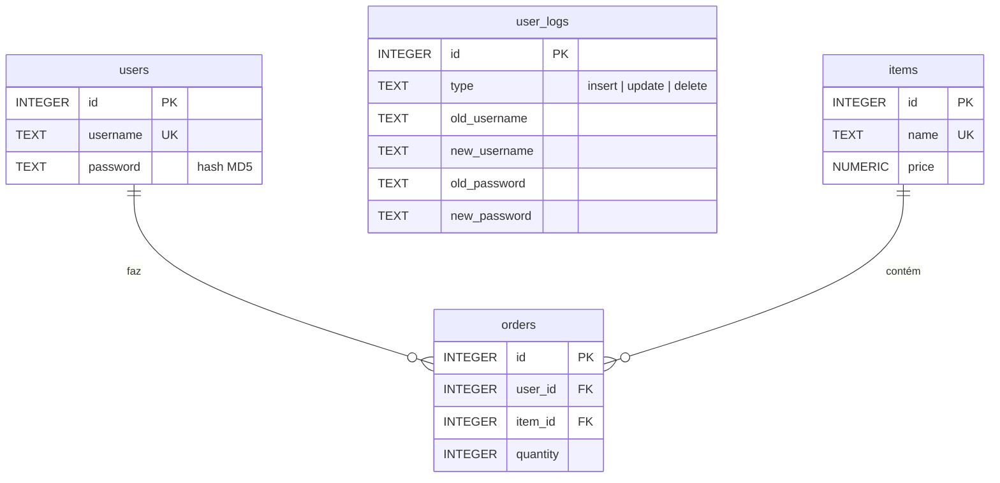

# Don't Panic!

**Etapa 4 · Escrita** · [Enunciado oficial](https://cs50.harvard.edu/sql/psets/3/dont-panic/)

`UPDATE` · `DELETE` · `INSERT ... SELECT` · triggers · hash MD5 · trilha de auditoria

## Contexto

Exercício de teste de invasão (pentest) autorizado. Uma pequena empresa contratou você para mostrar as falhas do banco SQLite que sustenta o site dela. Você tem acesso ao banco e cinco minutos antes que alguém perceba.

## Problema a resolver

Num único script, [`hack.sql`](hack.sql):

1. Trocar a senha da conta `admin` para "oops!". As senhas ficam guardadas como hash MD5, então o valor gravado é o hash.
2. **Apagar** o registro dessa troca nos logs.
3. **Plantar** um log falso dizendo que a senha do admin passou a ser a do usuário `emily33`, sem alterar de fato a senha do admin para essa.

O ponto central: o banco tem **triggers** (`log_user_updates`, `log_user_deletes`, `log_user_inserts`) que gravam em `user_logs` toda alteração em `users`. O ataque precisa levar esse comportamento em conta.

## Modelo de dados



`user_logs` não tem chave estrangeira: é alimentada só pelos triggers de `users`.

## Solução

| Passo | Comando | Efeito |
|---|---|---|
| 1 | `UPDATE "users" SET "password" = '982c03...16e7' WHERE "username" = 'admin'` | Senha trocada. O trigger `log_user_updates` registra a troca automaticamente. |
| 2 | `DELETE FROM "user_logs" WHERE "type" = 'update' AND "old_username" = 'admin' AND "new_password" = '982c03...16e7'` | Apaga exatamente o registro criado pelo trigger, identificado pelo conteúdo e não por um id fixo. |
| 3 | `INSERT INTO "user_logs" (...) SELECT 'update', 'admin', 'admin', <hash antigo>, "password" FROM "users" WHERE "username" = 'emily33'` | Log falso com o hash **real** da senha de emily33, lido do banco. |

`982c0381c279d139fd221fce974916e7` é o MD5 de `oops!` (conferido com `printf 'oops!' | md5`).

## Evidência

Resultado da verificação automática, rodando sobre um banco recém-criado por `reset.sql`:

```
senha do admin          → 982c0381c279d139fd221fce974916e7   (MD5 de "oops!")
logs com a senha nova   → 0                                   (rastro apagado)
último log do admin     → new_password = senha de emily33     (log falso plantado)
```

## Como executar

```bash
sqlite3 dont-panic.db ".read reset.sql" ".read hack.sql"
```

`reset.sql` é o script da distribuição do curso que recria o banco no estado original.

## Revisão pós-curso

- **O `DELETE` não depende mais de `WHERE "id" = 52`.** O id 52 só é o certo num banco recém-criado. Agora o registro é localizado pelo conteúdo (tipo, usuário e hash novo).
- **O hash de emily33 vem de um `SELECT`** em vez de ser copiado à mão para o script, o que elimina erro de digitação.
- Textos passaram de aspas duplas para aspas simples.

## O que isto ensina do lado da defesa

- MD5 sem *salt* não protege senhas: o hash de "oops!" é o mesmo em qualquer sistema e aparece em tabelas públicas. O certo é bcrypt, scrypt ou Argon2.
- Logs gravados na mesma base, com as mesmas permissões, podem ser apagados por quem invadiu a base. Trilhas de auditoria confiáveis precisam ser *append-only* e ficar fora do alcance de quem escreve nos dados.
