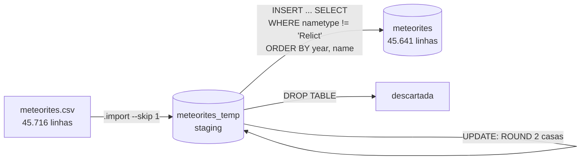
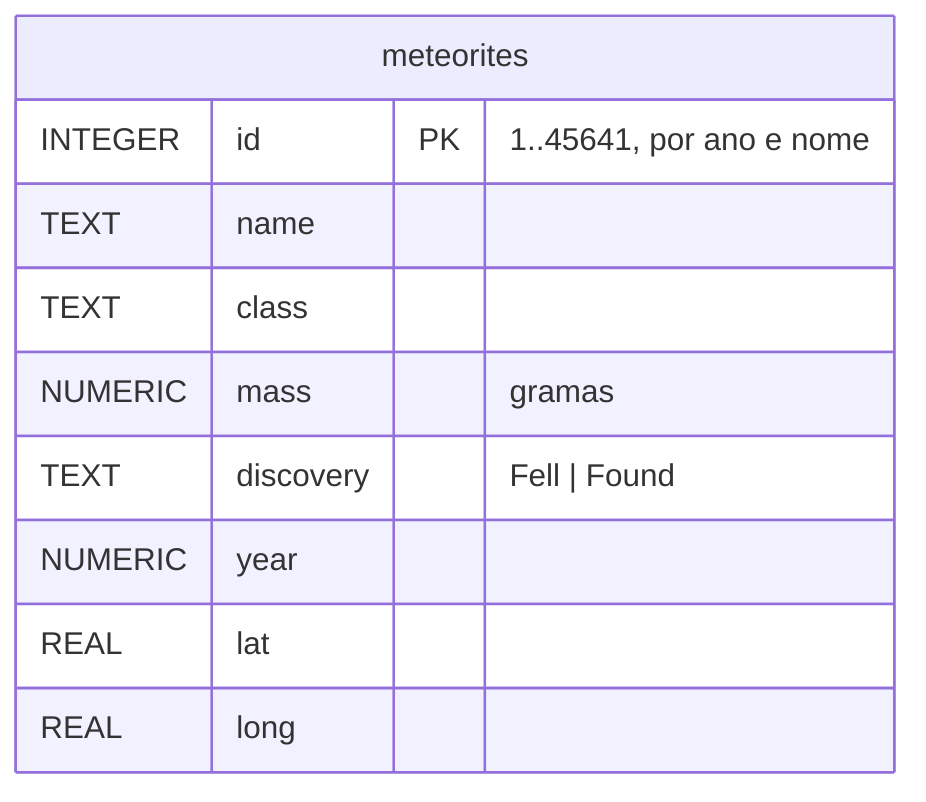

# Meteorite Cleaning

**Etapa 4 · Escrita** · [Enunciado oficial](https://cs50.harvard.edu/sql/psets/3/meteorites/)

ETL · `.import` de CSV · tabela de staging · `UPDATE` para limpeza · `ROUND` · `INSERT ... SELECT ... ORDER BY` · reatribuição de chaves

## Contexto

A NASA publica um conjunto aberto de dados com os pousos de meteoritos registrados na Terra. O arquivo `meteorites.csv` tem 45.716 linhas, com nome, classificação, massa, ano e coordenadas de cada meteorito, mas chega "sujo": valores vazios, casas decimais demais e registros que não são meteoritos de verdade.

## Problema a resolver

Como engenheiro de dados da NASA, escrever [`import.sql`](import.sql) para carregar o CSV num banco SQLite e entregar uma tabela `meteorites` limpa, seguindo as regras do enunciado:

| Regra | Implementação |
|---|---|
| Valores vazios viram `NULL` (`mass`, `year`, `lat`, `long`) | `UPDATE ... SET col = NULL WHERE col = ''` |
| `mass`, `lat` e `long` arredondados para 2 casas | `UPDATE ... SET col = ROUND(col, 2)` |
| Excluir meteoritos com `nametype` "Relict" (restos muito degradados) | filtro no `INSERT ... SELECT` |
| Remover a coluna `nametype` | a coluna não é levada para a tabela final |
| Ordenar por ano (mais antigo primeiro) e, no empate, por nome | `ORDER BY "year", "name"` |
| Reatribuir os ids a partir de 1, nessa ordem | `id INTEGER PRIMARY KEY` gerado na inserção ordenada |

## Pipeline





## Destaques

- **Staging antes da tabela final.** O CSV entra numa tabela temporária com os nomes das colunas originais, é limpo lá dentro e só então vai para a tabela definitiva. A tabela final recebe dados já limpos, com `NOT NULL` e `CHECK ("discovery" IN ('Fell', 'Found'))`.
- **Os ids saem da ordenação.** Como `id` é `INTEGER PRIMARY KEY` e a inserção é feita com `ORDER BY "year", "name"`, o SQLite numera as linhas de 1 em diante, já na ordem pedida.
- **Ordem das etapas.** Os vazios viram `NULL` antes do `ROUND`. Caso contrário, `ROUND('')` devolveria `0.0` e uma massa desconhecida viraria massa zero.

## Evidência

Resultado da verificação automática:

```
linhas na tabela final       → 45641   (45.716 do CSV − 75 "Relict")
colunas                      → 8       (nametype removida)
strings vazias restantes     → 0
faixa de ids                 → 1-45641
```

Primeiras linhas (ano nulo vem primeiro na ordenação do SQLite):

| id | name | class | mass | discovery | year | lat | long |
|---|---|---|---|---|---|---|---|
| 1 | Apache Junction | Iron, IIIAB | 25000 | Found | | 33.45 | -111.52 |
| 2 | Asarco Mexicana | Iron, IIIAB | | Found | | | |
| 3 | Aus | L | 30.2 | Found | | -26.67 | 16.25 |

## Como executar

```bash
cat import.sql | sqlite3 meteorites.db
```

## Limitações

- Registros sem ano (`NULL`) aparecem antes de todos os outros, porque o SQLite ordena `NULL` primeiro. O enunciado não define esse caso. `ORDER BY "year" NULLS LAST` levaria esses registros para o fim.
