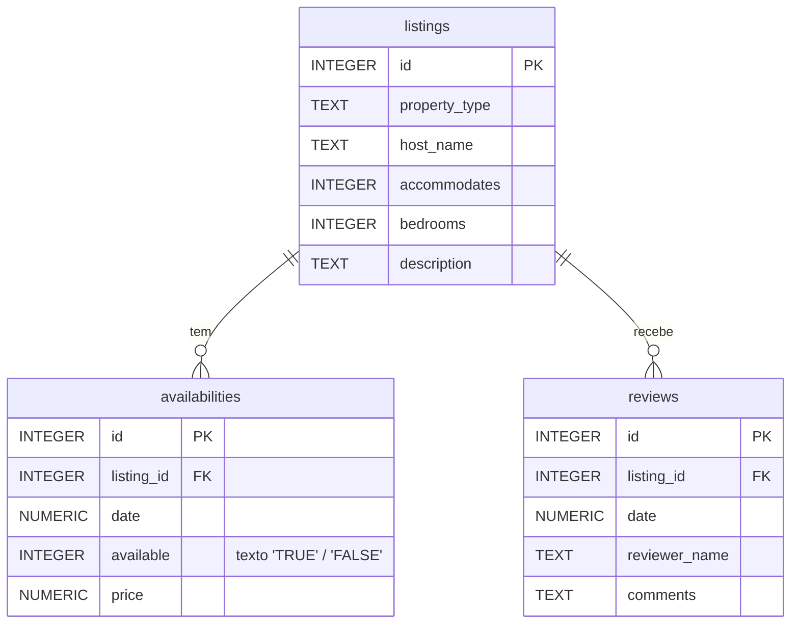

# Bed and Breakfast

**Etapa 5 · Views** · [Enunciado oficial](https://cs50.harvard.edu/sql/psets/4/bnb/)

`CREATE VIEW` · views de segurança (ocultar colunas) · `JOIN` · `COUNT` + `GROUP BY` · filtro por período · Top-N

## Contexto

A prefeitura de Boston quer entender como o Airbnb mudou o turismo na cidade. O banco `bnb.db` (86 MB, dados do [Inside Airbnb](https://insideairbnb.com/)) tem 3.973 anúncios, 766.906 registros de disponibilidade diária e 174.512 avaliações.

## Problema a resolver

Como analista de dados da prefeitura, criar 5 views que respondem às perguntas recorrentes da equipe, cada uma independente das outras:

| Arquivo | View | O que entrega |
|---|---|---|
| [`no_descriptions.sql`](no_descriptions.sql) | `no_descriptions` | Todos os anúncios **sem** a coluna `description` (texto longo) |
| [`one_bedrooms.sql`](one_bedrooms.sql) | `one_bedrooms` | Anúncios de 1 quarto: id, tipo, anfitrião, capacidade |
| [`available.sql`](available.sql) | `available` | Cada data em que cada anúncio está disponível |
| [`frequently_reviewed.sql`](frequently_reviewed.sql) | `frequently_reviewed` | Os 100 anúncios mais avaliados |
| [`june_vacancies.sql`](june_vacancies.sql) | `june_vacancies` | Dias vagos de cada anúncio em junho de 2023 |

## Modelo de dados



## Destaques

- **Conhecer o dado antes de filtrar.** `availabilities.available` é declarada `INTEGER`, mas guarda os textos `'TRUE'` e `'FALSE'`. Um filtro `= 1` não devolveria nada. As views comparam com `'TRUE'`.
- **Desempate completo no Top-N.** `frequently_reviewed` ordena por número de avaliações, depois tipo e anfitrião, como o enunciado pede, para que o corte em 100 seja determinístico.
- **Views como camada de acesso.** `no_descriptions` mostra um uso real de views: expor a tabela sem uma coluna pesada ou sensível, sem duplicar dados.

## Evidência

Verificação automática (as views são criadas como `TEMP VIEW`, sem alterar o banco):

| View | Linhas | Colunas |
|---|---|---|
| `no_descriptions` | 3973 | id, property_type, host_name, accommodates, bedrooms |
| `one_bedrooms` | 1228 | id, property_type, host_name, accommodates |
| `available` | 405201 | id, property_type, host_name, date |
| `frequently_reviewed` | 100 | id, property_type, host_name, reviews |
| `june_vacancies` | 1895 | id, property_type, host_name, days_vacant |

Os 3 primeiros de `frequently_reviewed`:

| id | property_type | host_name | reviews |
|---|---|---|---|
| 4090224 | Entire home | Tiffany | 860 |
| 18290558 | Private room in home | Boris & Susan | 786 |
| 815639 | Entire condo | Jason | 773 |

## Como executar

```bash
sqlite3 bnb.db ".read frequently_reviewed.sql" "SELECT * FROM frequently_reviewed LIMIT 10;"
```

## Revisão pós-curso

- **`one_bedrooms` tinha uma coluna a mais.** A versão entregue incluía `bedrooms`, mas o enunciado pede só `id`, `property_type`, `host_name` e `accommodates`. Como o filtro é `bedrooms = 1`, a coluna repetia o mesmo valor em todas as linhas.

## Limitações

- **Junho incompleto.** As disponibilidades começam em 21/06/2023, então `days_vacant` vai no máximo a 10. Os números de junho cobrem 10 dias, não o mês inteiro.
- **Anúncios sem vaga ficam de fora.** `june_vacancies` usa `JOIN` + `WHERE available = 'TRUE'`, então anúncios com zero dias vagos não aparecem (1.895 de 3.973). Um `LEFT JOIN` com a condição no `ON` incluiria esses anúncios com `days_vacant = 0`.
