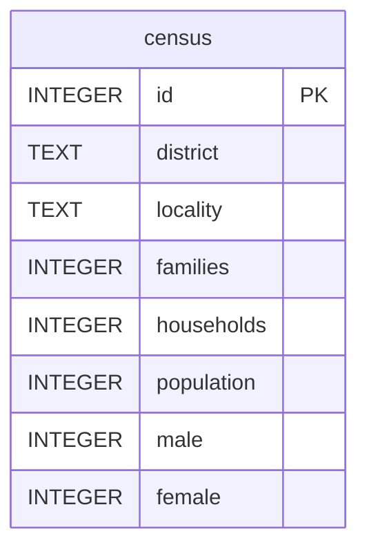

# Census Taker

**Etapa 5 · Views** · [Enunciado oficial](https://cs50.harvard.edu/sql/psets/4/census/)

`CREATE VIEW` · `SUM` · `GROUP BY` · `ORDER BY` · `LIKE` · agregação em vários níveis

## Contexto

Você trabalha como recenseador para o governo do Nepal. O banco `census.db` tem 753 localidades, cada uma com distrito, número de famílias, domicílios, população total e população por sexo.

## Problema a resolver

Transformar a tabela bruta em **views** prontas para o governo consultar. Cada view fica em seu próprio arquivo e não pode depender de outra view:

| Arquivo | View | Conteúdo |
|---|---|---|
| [`rural.sql`](rural.sql) | `rural` | Todas as colunas, só das localidades rurais (com "rural" no nome) |
| [`total.sql`](total.sql) | `total` | Soma nacional de famílias, domicílios, população, homens e mulheres |
| [`by_district.sql`](by_district.sql) | `by_district` | As mesmas somas, por distrito |
| [`most_populated.sql`](most_populated.sql) | `most_populated` | As somas por distrito, do mais populoso para o menos |

## Modelo de dados



## Destaques

- **Views independentes.** `most_populated` repete a agregação de `by_district` em vez de fazer `SELECT * FROM by_district`, porque o enunciado exige que cada view se sustente sozinha. Assim, apagar uma view não quebra outra.
- **Escolha da coluna do filtro.** O enunciado não diz em que coluna procurar "rural". Os dados mostram que a palavra só aparece em `locality` (461 localidades, contra 0 em `district`).

## Evidência

Verificação automática (as views são criadas como `TEMP VIEW`, sem alterar o banco):

| View | Linhas | Colunas |
|---|---|---|
| `rural` | 461 | id, district, locality, families, households, population, male, female |
| `total` | 1 | families, households, population, male, female |
| `by_district` | 77 | district, families, households, population, male, female |
| `most_populated` | 77 | district, families, households, population, male, female |

Primeiras linhas de `most_populated`:

| district | families | households | population | male | female |
|---|---|---|---|---|---|
| Kathmandu | 537916 | 275806 | 1988606 | 1001798 | 986808 |
| Morang | 274651 | 241415 | 1147186 | 557527 | 589659 |
| Rupandehi | 241432 | 195087 | 1117667 | 546297 | 571370 |

## Como executar

```bash
sqlite3 census.db ".read most_populated.sql" "SELECT * FROM most_populated LIMIT 5;"
```

## Limitações

- O `ORDER BY` dentro de `most_populated` funciona no SQLite, mas o padrão SQL não garante a ordem de uma view. Quem consome a view deveria repetir o `ORDER BY`.
