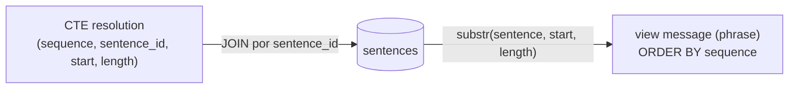

# The Private Eye

**Etapa 5 · Views** · [Enunciado oficial](https://cs50.harvard.edu/sql/psets/4/private/)

`CREATE VIEW` · CTE (`WITH`) · tabela literal com `VALUES` · `substr` · `JOIN` · ordenação controlada

## Contexto

O pato de borracha do CS50 sumiu, e a pista está na mesa de um detetive: uma lista de trios de números e um exemplar de *As Aventuras de Sherlock Holmes*. É uma **cifra de livro**: cada trio aponta para uma frase do livro, a posição do caractere inicial e o tamanho do trecho. O banco `private.db` tem as 5.647 frases do livro na tabela `sentences`.

## Problema a resolver

Decodificar os 8 trios e entregar o resultado como uma view `message`, com uma coluna `phrase` e uma linha por trecho, na ordem certa. O script [`private.sql`](private.sql) precisa recriar tudo a partir de um banco limpo.

| # | Frase | Início | Tamanho |
|---|---|---|---|
| 1 | 14 | 98 | 4 |
| 2 | 114 | 3 | 5 |
| 3 | 618 | 72 | 9 |
| 4 | 630 | 7 | 3 |
| 5 | 932 | 12 | 5 |
| 6 | 2230 | 50 | 7 |
| 7 | 2346 | 44 | 10 |
| 8 | 3041 | 14 | 5 |

## Solução

Os trios entram como uma **tabela literal dentro de uma CTE** (`WITH "resolution" AS (VALUES ...)`), unida a `sentences` pelo número da frase. `substr(sentence, start, length)` extrai cada trecho, e uma coluna `sequence` garante a ordem de leitura.



## Destaques

- **Nenhuma tabela extra.** O enunciado permite criar uma tabela para os trios. A CTE com `VALUES` deixa os dados dentro da própria view, então o script não altera o schema do banco e pode rodar várias vezes.
- **Ordem explícita.** A coluna `sequence` existe só para ordenar. Sem ela, a ordem do `JOIN` dependeria do plano de execução, e a mensagem poderia sair embaralhada.

## Evidência

```sql
SELECT "phrase" FROM "message";
```

| phrase |
|---|
| find |
| me in |
| the place |
| you |
| least |
| expect. |
| behind the |
| books |

Mensagem decodificada: ***"find me in the place you least expect. behind the books"***.

## Como executar

```bash
sqlite3 private.db ".read private.sql" "SELECT phrase FROM message;"
```

## Limitações

- Como em `census`, o `ORDER BY` dentro da view funciona no SQLite, mas não é garantido pelo padrão SQL.
