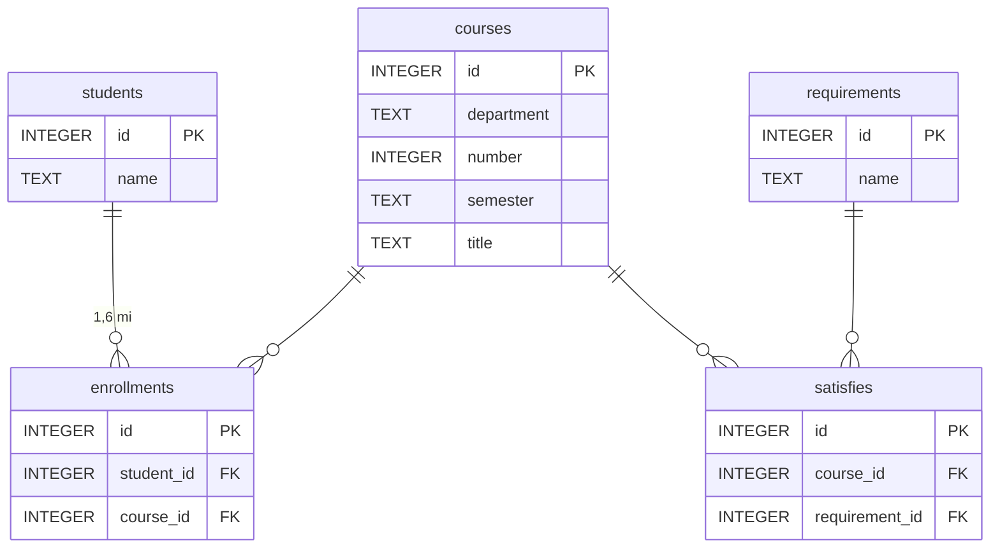

# your.harvard

**Etapa 6 · Otimização** · [Enunciado oficial](https://cs50.harvard.edu/sql/psets/5/your.harvard/)

projeto de índices · índices compostos · índice coberto · `EXPLAIN QUERY PLAN` · equilíbrio entre tempo e espaço em disco

## Contexto

Os alunos de Harvard usam o *my.harvard* para buscar disciplinas e se matricular, e o sistema é conhecido por ser lento. O banco `harvard.db` simula esse sistema: 50.000 alunos, 28.182 disciplinas e **1.600.000 matrículas**, além de requisitos acadêmicos.

## Problema a resolver

Escrever [`indexes.sql`](indexes.sql) para acelerar as 7 consultas típicas do sistema, listadas em [`consultas.sql`](consultas.sql), **sem indexar tudo**. Cada índice ocupa disco e torna `INSERT`, `UPDATE` e `DELETE` mais lentos. O critério é criar só índices que mudam o plano de alguma consulta.

## Modelo de dados



## Solução: 5 índices

| Índice | Colunas | Consultas atendidas | Justificativa |
|---|---|---|---|
| `enrollments_by_student` | `enrollments(student_id)` | Q1, Q6 | "Disciplinas de um aluno" varria 1,6 milhão de linhas |
| `enrollments_by_course` | `enrollments(course_id)` | Q2, Q3 | "Alunos de uma disciplina" e contagem de matrículas |
| `courses_by_department_semester_number` | `courses(department, semester, number)` | Q2, Q4 | Composto: Q4 usa o prefixo `(department, semester)` e Q2 usa as três colunas, como **índice coberto** |
| `satisfies_by_course` | `satisfies(course_id)` | Q5, Q6 | Requisito cumprido por uma disciplina |
| `courses_by_title_semester` | `courses(title, semester)` | Q5 | Busca por título exato + semestre, também coberta |

**Ordem das colunas no índice composto.** `department, semester, number` foi escolhida porque Q4 filtra só por departamento e semestre (prefixo do índice) e Q2 filtra pelos três. Com `number` em segundo lugar, Q4 não poderia usar o índice.

## Evidência

### Planos de execução, antes → depois

| Consulta | Antes | Depois |
|---|---|---|
| Q1 · disciplinas do aluno 3 | `SCAN enrollments` | `SEARCH enrollments USING INDEX enrollments_by_student` |
| Q2 · alunos de CS50 no Fall 2023 | `SCAN enrollments` + `SCAN courses` | `SEARCH ... enrollments_by_course` + `SEARCH ... COVERING INDEX courses_by_department_semester_number` |
| Q3 · matrículas por disciplina | `SCAN enrollments` | `SCAN courses` + `SEARCH ... COVERING INDEX enrollments_by_course` |
| Q4 · CS no Spring 2024 | `SCAN courses` | `SEARCH courses USING INDEX courses_by_department_semester_number` |
| Q5 · requisito de "Advanced Databases" | `SCAN satisfies` + `SCAN courses` | `SEARCH ... satisfies_by_course` + `SEARCH ... COVERING INDEX courses_by_title_semester` |
| Q6 · disciplinas por requisito do aluno 8 | `SCAN satisfies` + `SCAN enrollments` | `SEARCH ... satisfies_by_course` + `SEARCH ... enrollments_by_student` |
| Q7 · títulos com prefixo "History" | `SCAN courses` | `SCAN courses` *(sem mudança, ver limitações)* |

Varreduras completas de tabela nas 7 consultas: **10 → 2** (conferido por [`scripts/verificar.sh`](../../scripts/verificar.sh)).

### Tempo de execução

Mediana de 5 execuções, banco carregado em memória, SQLite 3.54, Apple M2. Os dados estão em [`docs/harvard_benchmark.csv`](../../docs/harvard_benchmark.csv).


| Consulta | Antes (ms) | Depois (ms) | Ganho |
|---|---:|---:|---:|
| Q1 | 36,21 | 0,02 | ~1.930× |
| Q2 | 42,45 | 0,03 | ~1.650× |
| Q3 | 349,00 | 4,01 | ~87× |
| Q4 | 0,73 | 0,04 | ~17× |
| Q5 | 0,32 | < 0,01 | ~200× |
| Q6 | 28,78 | 0,03 | ~1.130× |
| Q7 | 1,01 | 1,01 | 1× |

### Custo em disco

| Objeto | Tamanho |
|---|---:|
| Banco sem índices | 25,8 MB |
| `enrollments_by_student` | 18,3 MB |
| `enrollments_by_course` | 17,7 MB |
| `courses_by_title_semester` | 1,2 MB |
| `courses_by_department_semester_number` | 0,9 MB |
| `satisfies_by_course` | 0,3 MB |
| **Banco com índices** | **64,2 MB (+149%)** |

**Leitura honesta do trade-off.** Quase todo o espaço extra (36 MB) vem dos dois índices em `enrollments`, a tabela de 1,6 milhão de linhas. Eles também respondem pelos maiores ganhos (Q1, Q2, Q3 e Q6, de ~87× a ~1.930×). Os três índices em `courses` e `satisfies` somam 2,4 MB. Num sistema de matrículas, com muito mais leitura do que escrita, o custo se justifica. Num sistema com muita escrita em `enrollments`, cada matrícula passaria a atualizar dois índices a mais.

## Como executar

```bash
sqlite3 harvard.db ".read indexes.sql"
sqlite3 harvard.db "EXPLAIN QUERY PLAN SELECT ..."   # qualquer consulta de consultas.sql
```

Para refazer as medições e o gráfico (só biblioteca padrão do Python):

```bash
python3 scripts/grafico_harvard.py   # a partir da raiz do repositório
```

## Limitações e próximos passos

- **Q3 e Q7 ainda varrem `courses`** (28 mil linhas). Num teste posterior, um índice simples em `courses(semester)` trocou as duas varreduras por `SEARCH`: Q3 caiu de 3,9 para 3,4 ms, já que o custo dela está na contagem de matrículas, e Q7 de 1,0 para 0,2 ms. É o próximo índice candidato. Ele não está em `indexes.sql` porque o arquivo é a versão entregue no curso.
- **O prefixo de `LIKE` não aproveita índices comuns.** `LIKE 'History%'` ignora maiúsculas e minúsculas, então o SQLite só usaria um índice em `title` se ele fosse `COLLATE NOCASE` (ou com `PRAGMA case_sensitive_like = ON`). No teste, o planejador preferiu o índice por semestre.
