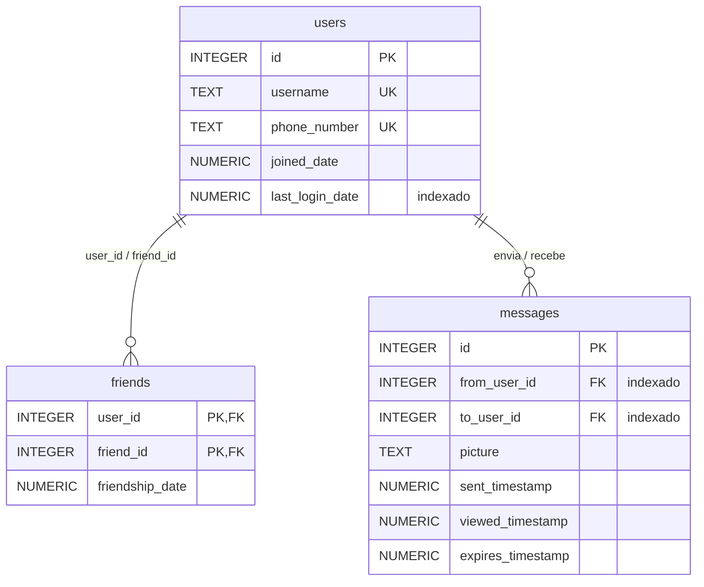

# In a Snap

**Etapa 6 · Otimização** · [Enunciado oficial](https://cs50.harvard.edu/sql/psets/5/snap/)

índices · `EXPLAIN QUERY PLAN` · índice coberto · `INTEGER PRIMARY KEY` · subconsultas · `INTERSECT`

## Contexto

Um aplicativo de mensagens em que as fotos somem 30 segundos depois de vistas. Com milhares de usuários esperando entrega instantânea, as consultas precisam ser corretas **e** usar os índices certos. O banco `snap.db` tem 2.500 usuários, 125.000 mensagens e 20.000 amizades.

## Problema a resolver

Escrever 5 consultas, cada uma obrigada a usar um índice específico, o que se confere com `EXPLAIN QUERY PLAN`:

| # | Pergunta | Índice exigido |
|---|---|---|
| [1](1.sql) | Usuários que fizeram login a partir de 01/01/2024 | `search_users_by_last_login` |
| [2](2.sql) | Quando expira a mensagem de id 151 | chave primária de `messages` |
| [3](3.sql) | Os 3 usuários para quem `creativewisdom377` mais envia mensagens | `search_messages_by_from_user_id` |
| [4](4.sql) | O usuário mais popular, que é o que mais recebe mensagens | `search_messages_by_to_user_id` |
| [5](5.sql) | Amigos em comum de `lovelytrust487` e `exceptionalinspiration482` | `sqlite_autoindex_friends_1` |

## Modelo de dados



## Evidência: planos de execução

Todas as 5 consultas usam o índice exigido (conferido por [`scripts/verificar.sh`](../../scripts/verificar.sh)).

**1.sql**: busca por faixa no índice, sem varrer `users`:
```
SEARCH users USING INDEX search_users_by_last_login (last_login_date>?)
```

**2.sql**: acesso direto pela chave primária:
```
SEARCH messages USING INTEGER PRIMARY KEY (rowid=?)
```

**3.sql**: o nome de usuário vira id por um índice coberto, e as mensagens são filtradas pelo índice do remetente:
```
SEARCH messages USING INDEX search_messages_by_from_user_id (from_user_id=?)
SCALAR SUBQUERY 1
  SEARCH users USING COVERING INDEX sqlite_autoindex_users_1 (username=?)
USE TEMP B-TREE FOR GROUP BY
USE TEMP B-TREE FOR ORDER BY
```

**4.sql**: a contagem por destinatário lê **só o índice** (coberto), sem tocar na tabela de 125 mil mensagens:
```
SEARCH users USING INTEGER PRIMARY KEY (rowid=?)
SCALAR SUBQUERY 1
  SCAN messages USING COVERING INDEX search_messages_by_to_user_id
  USE TEMP B-TREE FOR ORDER BY
```

**5.sql**: duas buscas no índice da chave primária de `friends`, combinadas por `INTERSECT`:
```
MERGE (INTERSECT)
  LEFT:  SEARCH friends USING COVERING INDEX sqlite_autoindex_friends_1 (user_id=?)
  RIGHT: SEARCH friends USING COVERING INDEX sqlite_autoindex_friends_1 (user_id=?)
```

## Destaques

- **Subconsulta em vez de `JOIN` para traduzir nome em id** (3, 4 e 5). A subconsulta escalar resolve o id uma vez, pelo índice único de `username`, e a consulta externa usa o índice exigido diretamente.
- **`INTERSECT` para amigos em comum.** É a tradução direta de "amigo de A **e** amigo de B", e cada lado é uma busca indexada.

## Como executar

```bash
sqlite3 snap.db "EXPLAIN QUERY PLAN $(cat 4.sql)"
```

## Limitações

- Em `3.sql` e `4.sql`, o `GROUP BY` + `ORDER BY COUNT(*)` ainda cria árvores temporárias (`USE TEMP B-TREE`). É inevitável quando se ordena por um valor agregado. Se essa consulta fosse crítica, a saída seria um contador mantido por trigger ou uma tabela de resumo.
