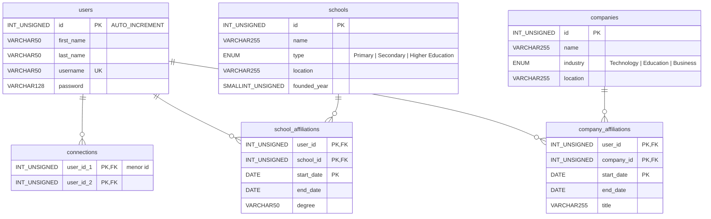

# Happy to Connect (MySQL)

**Etapa 7 · Escala** · [Enunciado oficial](https://cs50.harvard.edu/sql/psets/6/connect/)

MySQL 8.0 · tipos precisos (`INT UNSIGNED`, `VARCHAR(n)`, `SMALLINT`, `DATE`) · `ENUM` · `AUTO_INCREMENT` · `UNIQUE` · `CHECK` · chaves compostas

## Contexto

É o mesmo problema da [Etapa 3](../../03-modelagem/connect/): o banco de uma rede profissional no estilo do LinkedIn. Desta vez a implementação é em **MySQL 8.0**, o tipo de SGBD usado quando o sistema sai do arquivo único do SQLite para um servidor com vários usuários simultâneos.

## Problema a resolver

Reescrever o schema em MySQL escolhendo **os tipos mais precisos possíveis** e atendendo às novas regras do enunciado:

- tipo de escola restrito a `Primary`, `Secondary` e `Higher Education`;
- setor da empresa restrito a `Technology`, `Education` e `Business`;
- senha com espaço para hashes de até 128 caracteres.

Dados de exemplo: Claudine Gay (PhD em Harvard, 1993–1998) e Reid Hoffman (CEO e Chairman do LinkedIn, 2003–2007).

## Modelo de dados



Arquivos: [`schema.sql`](schema.sql) e [`dados_exemplo.sql`](dados_exemplo.sql).

## SQLite (Etapa 3) × MySQL (Etapa 7)

| Aspecto | SQLite (Etapa 3) | MySQL (esta versão) |
|---|---|---|
| Tipos | `INTEGER`, `TEXT`, `NUMERIC` (afinidade) | `INT UNSIGNED`, `VARCHAR(n)`, `SMALLINT UNSIGNED`, `DATE` |
| Domínio de valores | texto livre | `ENUM` para tipo de escola e setor |
| `username` | pode repetir | `UNIQUE NOT NULL` |
| Datas | `TEXT` | `DATE` + `CHECK (end_date IS NULL OR end_date >= start_date)` |
| Chave do vínculo | `id` substituto | `(user_id, school_id, start_date)`: a mesma pessoa pode voltar à mesma escola em outra data, mas não há duplicatas |
| Conexão mútua | `CHECK (user_id < connected_user_id)` | mesma técnica: `CHECK (user_id_1 < user_id_2)` |

## Decisões de modelagem

- **`UNSIGNED` em ids e ano de fundação**, que nunca são negativos. Isso dobra o intervalo positivo do tipo e documenta a regra no próprio schema.
- **`SMALLINT UNSIGNED` para o ano**, que cabe em 2 bytes (0–65.535) contra 4 de um `INT`.
- **`VARCHAR(128)` para senha**, o tamanho que o enunciado indica para hashes. A coluna já comporta um hash real, embora os dados de exemplo usem "password", como o enunciado permite.

## Como executar

Validação automática num MySQL 8.0 descartável:

```bash
./scripts/verificar_mysql.sh
```

O script sobe um container `mysql:8.0`, cria o banco `linkedin`, carrega `schema.sql` e `dados_exemplo.sql` e testa se as constraints **rejeitam** dados inválidos: um tipo de escola fora do `ENUM`, uma conexão invertida (`user_id_1 > user_id_2`) e uma data de saída anterior à de entrada. No fim, o container é removido.

Execução manual num servidor MySQL existente:

```bash
mysql -u root -p -e 'CREATE DATABASE `linkedin`;'
mysql -u root -p linkedin < schema.sql
mysql -u root -p linkedin < dados_exemplo.sql
```

## Limitações

- A validação em MySQL depende de Docker e não roda no `verificar.sh` principal, que usa só SQLite.
- `ENUM` deixa o domínio explícito, mas acrescentar um valor novo (um setor "Finance", por exemplo) exige `ALTER TABLE`. Uma tabela de domínio com chave estrangeira seria mais flexível.
