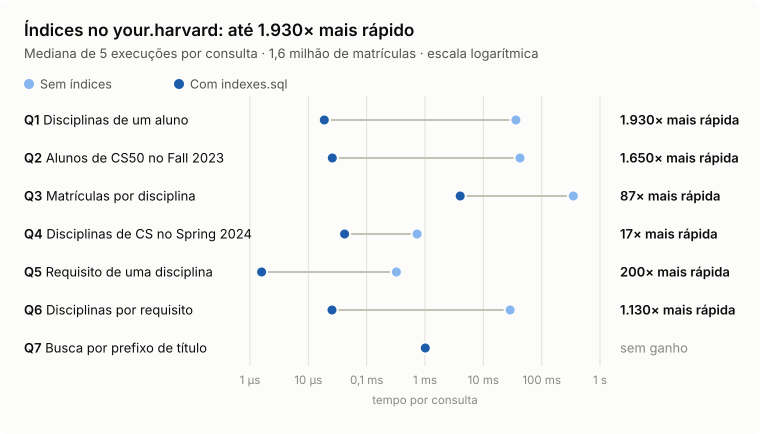

# SQL na prática: os 19 problemas do CS50 SQL (Harvard)

[](https://github.com/fernandofigueiredo-data/cs50-sql/actions/workflows/verificar.yml)

Consultas, modelagem relacional, ETL, views e otimização com índices em **SQLite** e **MySQL**, com cada solução **conferida automaticamente** contra os bancos de dados oficiais do curso.

> **Em números:** 19 problemas · 7 etapas · 81 arquivos de solução · 84 verificações automáticas, rodadas a cada push pelo GitHub Actions · bancos reais com até 1,6 milhão de linhas

<picture>
  <source media="(prefers-color-scheme: dark)" srcset="docs/harvard_benchmark-dark.svg">
  
</picture>

<sub>Medido com <a href="scripts/grafico_harvard.py"><code>scripts/grafico_harvard.py</code></a> (SQLite 3.54, Apple M2). Dados em <a href="docs/harvard_benchmark.csv"><code>docs/harvard_benchmark.csv</code></a>; detalhes em <a href="06-otimizacao/harvard/">your.harvard</a>.</sub>

---

## Destaques

| | Problema | O que foi feito | Resultado |
|---|---|---|---|
| ⚡ | [**your.harvard**](06-otimizacao/harvard/) | 5 índices (2 compostos, 3 usados como cobertos) para 7 consultas típicas de um sistema de matrículas com 1,6 mi de registros | Varreduras completas: **10 → 2**. Consulta mais lenta: **349 → 4 ms**. Custo medido e discutido: **+38 MB** em disco |
| ⚾ | [**Moneyball**](02-relacionamentos/moneyball/) | Análise de custo-benefício de jogadores do Oakland 2001: custo por rebatida e por RBI, com `JOIN` por (jogador, ano) | Interseção de dois rankings em uma consulta: **6 reforços** eficientes nos dois critérios |
| ☄️ | [**Meteorite Cleaning**](04-escrita/meteorites/) | Pipeline de ETL da NASA: staging, `NULL` para vazios, arredondamento, filtro e reatribuição de ids | **45.716 → 45.641** registros limpos, 0 strings vazias, ids sequenciais |
| 🔐 | [**Don't Panic!**](04-escrita/dont-panic/) | Pentest em SQL: troca de senha, remoção do rastro deixado por um *trigger* e log falso, mais uma análise do lado da defesa | Verificado num banco recém-criado: 0 rastros e log falso plantado |

## Competências demonstradas

| Competência | Onde aparece |
|---|---|
| Filtros, ordenação e agregação (`WHERE`, `LIKE`, `BETWEEN`, `GROUP BY`, `HAVING`) | [Cyberchase](01-consultas/cyberchase/) · [36 Views](01-consultas/views/) · [Players](01-consultas/players/) · [DESE](02-relacionamentos/dese/) |
| `JOIN`s de até 4 tabelas e chaves compostas | [DESE](02-relacionamentos/dese/) · [Moneyball](02-relacionamentos/moneyball/) |
| Subconsultas escalares, `IN (... LIMIT)`, `INTERSECT` | [Moneyball](02-relacionamentos/moneyball/) · [In a Snap](06-otimizacao/snap/) |
| Investigação documentada (consulta a consulta) | [Packages, Please](02-relacionamentos/packages/) |
| Modelagem relacional e normalização (N:N, auto-relacionamento, chaves compostas) | [ATL](03-modelagem/atl/) · [Happy to Connect](03-modelagem/connect/) · [Union Square Donuts](03-modelagem/donuts/) |
| Integridade (`PRIMARY KEY`, `FOREIGN KEY`, `CHECK`, `UNIQUE`, `NOT NULL`, `DEFAULT`) | todos da Etapa 3 · [connect-mysql](07-escala/connect-mysql/) |
| Escrita e triggers (`INSERT ... SELECT`, `UPDATE`, `DELETE`) | [Don't Panic!](04-escrita/dont-panic/) |
| ETL e limpeza de dados a partir de CSV | [Meteorite Cleaning](04-escrita/meteorites/) |
| Views e CTEs (`WITH ... VALUES`) | [Census Taker](05-views/census/) · [The Private Eye](05-views/private/) · [Bed and Breakfast](05-views/bnb/) |
| Índices, `EXPLAIN QUERY PLAN` e o equilíbrio entre tempo e espaço | [In a Snap](06-otimizacao/snap/) · [your.harvard](06-otimizacao/harvard/) |
| MySQL 8.0 (tipos precisos, `ENUM`, `AUTO_INCREMENT`) | [Happy to Connect (MySQL)](07-escala/connect-mysql/) |
| Escalabilidade (particionamento / *sharding*) | [From the Deep](07-escala/deep/) |
| Python + SQL com consultas parametrizadas (prevenção de SQL injection) | [Don't Panic! (Python)](07-escala/dont-panic-python/) |

## Trilha completa

Cada pasta tem um README com contexto, problema a resolver, diagrama ER, a solução comentada, evidências (saídas reais, planos de execução) e limitações.

### Etapa 1 · Consultas
| Problema | Cenário | Conceitos-chave |
|---|---|---|
| [Cyberchase](01-consultas/cyberchase/) | Catálogo de 140 episódios de uma série educativa da PBS | `WHERE`, `LIKE`, `BETWEEN`, `COUNT(DISTINCT)` |
| [36 Views](01-consultas/views/) | 72 xilogravuras de Hokusai e Hiroshige com métricas de imagem | `MAX`, `ROUND(AVG())`, Top-N com `LIMIT` |
| [Players](01-consultas/players/) | 20.769 jogadores da MLB, de 1871 a 2023 | `IS NULL`, precedência `AND`/`OR`, ordenação composta |

### Etapa 2 · Relacionamentos
| Problema | Cenário | Conceitos-chave |
|---|---|---|
| [Packages, Please](02-relacionamentos/packages/) | Rastrear 3 encomendas perdidas pelas leituras de código de barras | navegação por chaves estrangeiras, log de investigação |
| [DESE](02-relacionamentos/dese/) | Escolas, gastos e desempenho em Massachusetts | `JOIN` de 4 tabelas, `HAVING`, comparação com a média |
| [Moneyball](02-relacionamentos/moneyball/) | Jogadores subvalorizados para o Oakland em 2001 | `JOIN` por chave composta, métricas de custo, interseção de rankings |

### Etapa 3 · Modelagem
| Problema | Cenário | Conceitos-chave |
|---|---|---|
| [ATL](03-modelagem/atl/) | Passageiros, voos e check-ins do aeroporto mais movimentado do mundo | chave composta, `CHECK`, `DEFAULT CURRENT_TIMESTAMP` |
| [Happy to Connect](03-modelagem/connect/) | Rede profissional no estilo do LinkedIn | N:N, conexão mútua com `CHECK (a < b)` |
| [Union Square Donuts](03-modelagem/donuts/) | Ingredientes, cardápio e pedidos de uma doceria | tabelas associativas com atributos (`quantity`) |

### Etapa 4 · Escrita
| Problema | Cenário | Conceitos-chave |
|---|---|---|
| [Don't Panic!](04-escrita/dont-panic/) | Pentest: alterar a senha do admin e apagar o rastro | `UPDATE`, `DELETE`, triggers, MD5 |
| [Meteorite Cleaning](04-escrita/meteorites/) | Limpar e importar o dataset aberto de meteoritos da NASA | ETL, staging, `.import`, `INSERT ... SELECT` |

### Etapa 5 · Views
| Problema | Cenário | Conceitos-chave |
|---|---|---|
| [Census Taker](05-views/census/) | Censo do Nepal: 753 localidades em 77 distritos | views de agregação |
| [The Private Eye](05-views/private/) | Decifrar uma cifra de livro em *Sherlock Holmes* | CTE com `VALUES`, `substr` |
| [Bed and Breakfast](05-views/bnb/) | O impacto do Airbnb em Boston (766 mil registros de disponibilidade) | views de acesso, `COUNT` por período |

### Etapa 6 · Otimização
| Problema | Cenário | Conceitos-chave |
|---|---|---|
| [In a Snap](06-otimizacao/snap/) | Mensagens efêmeras com resposta instantânea | uso obrigatório de índices, `EXPLAIN QUERY PLAN` |
| [your.harvard](06-otimizacao/harvard/) | Acelerar o sistema de matrículas de Harvard | projeto de índices, benchmark antes/depois |

### Etapa 7 · Escala
| Problema | Cenário | Conceitos-chave |
|---|---|---|
| [Happy to Connect (MySQL)](07-escala/connect-mysql/) | A rede da Etapa 3, agora em MySQL 8.0 | tipos precisos, `ENUM`, `UNIQUE` |
| [From the Deep](07-escala/deep/) | Distribuir observações de um submarino entre 3 servidores | particionamento aleatório, por intervalo e por hash |
| [Don't Panic! (Python)](07-escala/dont-panic-python/) | Automatizar o pentest da Etapa 4 | Python + SQL parametrizado |

## Material de estudo: guia interativo de SQLite

[**Abrir o guia**](https://fernandofigueiredo-data.github.io/cs50-harvard-sql/guia-sqlite/) · [código-fonte](docs/guia-sqlite/index.html)

Página de referência em português que complementa as soluções. A primeira parte reúne os conceitos do curso na ordem das aulas: consultas, relacionamentos, modelagem, escrita, views e otimização. A segunda é um manual com 77 comandos do cliente `sqlite3` e de SQL, cada um com sintaxe, finalidade, exemplo copiável e resultado esperado. A página tem busca instantânea e filtro por categoria, e funciona offline: é um único arquivo HTML, sem dependências.

- Os exemplos são genéricos, com marcadores (`nome_da_tabela`, `condicao`) para adaptar a qualquer banco.
- O que vai além das anotações do curso leva o selo "complemento da documentação oficial", com link para [sqlite.org](https://www.sqlite.org/docs.html). Onde as anotações divergem da documentação, há uma nota ao lado do trecho (8 casos).
- Cores, tipografia e componentes seguem o design system em [`docs/guia-sqlite/design-system/MASTER.md`](docs/guia-sqlite/design-system/MASTER.md).

## Qualidade: como as soluções são verificadas

A cada push, o [GitHub Actions](.github/workflows/verificar.yml) baixa os bancos oficiais e roda [`scripts/verificar.sh`](scripts/verificar.sh); o resultado aparece no selo do topo. O script roda todas as soluções contra os bancos oficiais e compara o resultado com as **contagens de linhas publicadas nos enunciados**. Quando o enunciado não publica contagem, a comparação é feita com valores conferidos manualmente. O script também confere colunas das views, planos de execução, constraints e efeitos dos scripts de escrita. Nenhum banco é alterado: as consultas rodam em modo somente leitura e as views viram `TEMP VIEW`.

```
Etapa 1 — Consultas
  ✅ 01-consultas/players/9.sql → 516 linhas
  ...
Etapa 6 — Otimização
  ✅ 06-otimizacao/snap/4.sql usa search_messages_by_to_user_id
  ✅ 06-otimizacao/harvard SCANs completos depois dos índices → 2
...
Resumo: 84 ok, 0 falha(s)
```

**Revisão pós-curso.** Ao montar este repositório, todas as soluções foram revisadas contra os enunciados oficiais. Foram corrigidos **2 erros**: [`players/9.sql`](01-consultas/players/) devolvia 2.161 linhas em vez de 516, e [`bnb/one_bedrooms.sql`](05-views/bnb/) tinha uma coluna a mais. Também foram feitas **3 melhorias de robustez**: [`moneyball/8.sql`](02-relacionamentos/moneyball/), [`dont-panic/hack.sql`](04-escrita/dont-panic/) e a coluna de unidade em [`donuts`](03-modelagem/donuts/). Cada README registra o que mudou e por quê.

## Como reproduzir

**Requisitos:** `sqlite3` 3.40 ou mais recente, `curl` e `unzip`. Docker é opcional, só para validar a versão em MySQL.

```bash
git clone https://github.com/fernandofigueiredo-data/cs50-sql.git
cd cs50-sql
./scripts/baixar_dados.sh
./scripts/verificar.sh
```

`baixar_dados.sh` baixa os bancos oficiais do CS50 (cerca de 170 MB, por isso fora do repositório) e coloca cada um na pasta do seu problema. Para rodar uma solução isolada:

```bash
cd 02-relacionamentos/moneyball
sqlite3 moneyball.db < 12.sql
```

## Estrutura

```
.
├── 01-consultas/         cyberchase · views · players
├── 02-relacionamentos/   packages · dese · moneyball
├── 03-modelagem/         atl · connect · donuts          (schema.sql + dados_exemplo.sql)
├── 04-escrita/           dont-panic · meteorites
├── 05-views/             census · private · bnb
├── 06-otimizacao/        snap · harvard                  (+ consultas.sql com as consultas otimizadas)
├── 07-escala/            connect-mysql · deep · dont-panic-python
├── docs/                 gráfico e dados do benchmark
│   └── guia-sqlite/      guia interativo de SQLite (index.html + design system)
├── .github/workflows/    CI: verificar.yml (SQLite) e verificar-mysql.yml (MySQL)
└── scripts/
    ├── baixar_dados.sh       # baixa os bancos oficiais
    ├── verificar.sh          # 84 verificações em SQLite (roda no CI a cada push)
    ├── verificar_mysql.sh    # valida o schema MySQL num container descartável
    └── grafico_harvard.py    # benchmark do your.harvard → docs/*.svg
```

## Sobre o curso

[**CS50's Introduction to Databases with SQL**](https://cs50.harvard.edu/sql/) é um curso da Harvard University, ministrado por Carter Zenke e David J. Malan. Em 7 semanas ele vai de consultas básicas até modelagem, otimização e escala, usando SQLite e, no final, MySQL e PostgreSQL. Cada semana termina com problemas práticos sobre bancos de dados reais, que são os 19 resolvidos aqui.

## Créditos e licença

Os enunciados, bancos de dados e scripts de distribuição (por exemplo, `reset.sql`) pertencem ao CS50 da Harvard University e são distribuídos sob a licença [CC BY-NC-SA 4.0](https://creativecommons.org/licenses/by-nc-sa/4.0/). Os textos de contexto dos READMEs são paráfrases dos enunciados originais, com link para cada um. Fontes dos dados: Wikipedia (Cyberchase, 36 Views), Chadwick Bureau / Lahman (Players, Moneyball), Massachusetts DESE, NASA Open Data Portal (Meteorites), Open Data Nepal (Census), Inside Airbnb (BnB). Este repositório segue a mesma licença: veja [LICENSE](LICENSE).

## Autor

**Fernando Figueiredo** · [GitHub](https://github.com/fernandofigueiredo-data)
